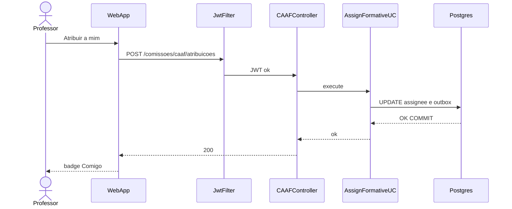

# F4.1b — Self-assign no pool CAAF

| Campo | Valor |
|---|---|
| HU | US-F4-001 |
| Escopo | atribui item a si → fila individual F3.5 |
| Atores | Professor, WebApp, JwtFilter, CAAFController, AssignFormativeUC, Postgres |
| Pré-condições | item sem responsável; `formative.review`; `_links.assign-member` |
| Origem | `docs/tcc-docs.md` §8.5 · CA-02 |

## Passos

1. Professor clica “Atribuir a mim”.
2. TX: UPDATE `assignee` + `outbox_event` (`formativas.assigned`).
3. Dispatcher filtra self (sem auto-notificação); cache CAAF invalidado; item em `/formativas?to=me`.

## Mermaid

## Export

[`F4.1b-self-assign.puml`](./F4.1b-self-assign.puml)
