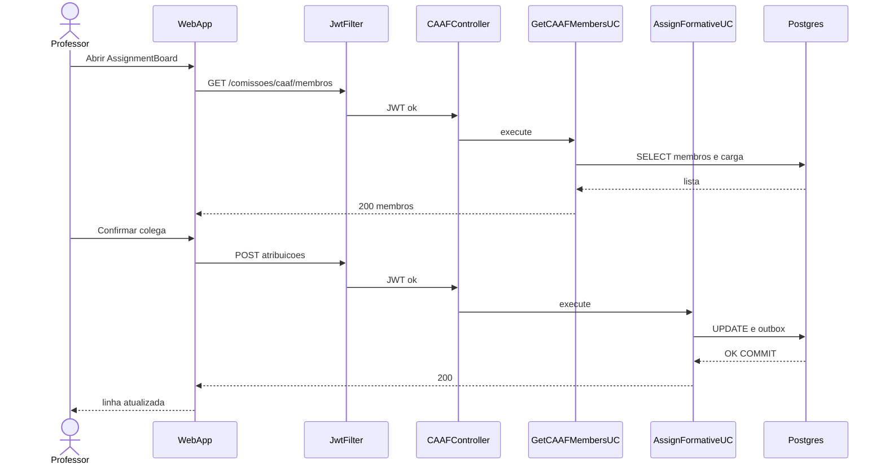

# F4.1c — Atribuir a outro membro (AssignmentBoard)

| Campo | Valor |
|---|---|
| HU | US-F4-001 |
| Escopo | overlay de carga → atribui a colega + outbox |
| Atores | Professor, WebApp, JwtFilter, CAAFController, GetCAAFMembersUC, AssignFormativeUC, Postgres |
| Pré-condições | item no pool ou comigo; ≥ 2 membros; `formative.review` |
| Origem | `docs/tcc-docs.md` §8.5 · CA-03 · RN-F4.1-02 |

## Passos

1. Abre AssignmentBoard; GET membros com carga (`EM_REVISAO`).
2. Confirma colega → TX: UPDATE assignee + `outbox_event` (`formativas.assigned`).
3. Item some da listagem do originador; colega notificado (in-app + e-mail).

## Mermaid

## Export

[`F4.1c-atribuir-membro.puml`](./F4.1c-atribuir-membro.puml)
