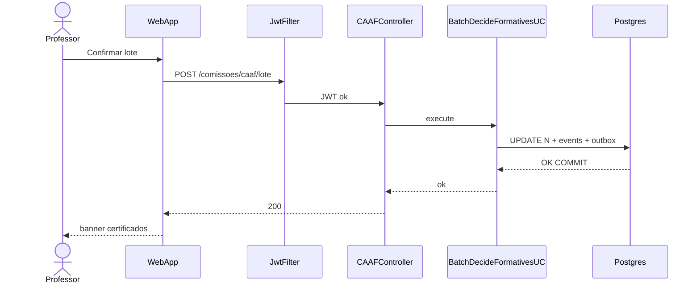

# F4.1d — Aprovação em lote (presença validada)

| Campo | Valor |
|---|---|
| HU | US-F4-001 |
| Escopo | `POST .../lote` só `EVENTO_INTERNO_PRESENCA_VALIDADA` |
| Atores | Professor, WebApp, JwtFilter, CAAFController, BatchDecideFormativesUC, Postgres |
| Pré-condições | N itens presença validada; BulkActionBar habilita aprovar; `formative.review` |
| Origem | `docs/tcc-docs.md` §8.5 · CA-04 · RN-F4.1-06 |

## Passos

1. Modal confirma N atividades; POST batch `decisao: APROVADA`.
2. TX única: N UPDATEs + `event_log` individual + `outbox_event` de lote.
3. Dispatcher fan-out → certificado por aluno.

## Mermaid

## Export

[`F4.1d-aprovacao-lote.puml`](./F4.1d-aprovacao-lote.puml)
