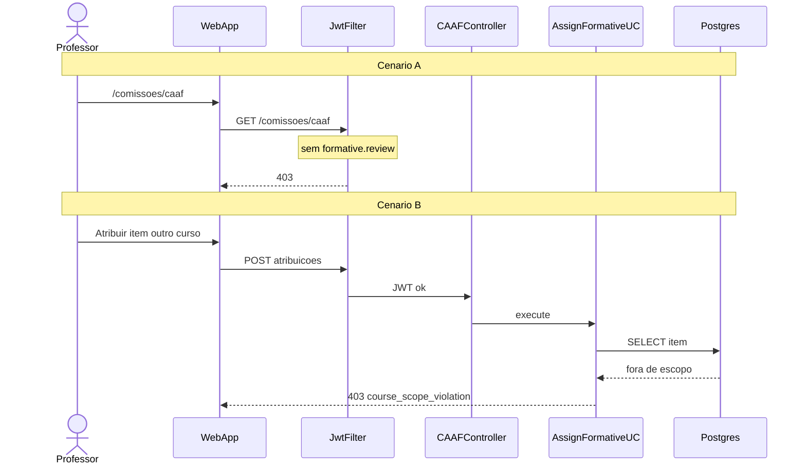

# F4.1e — 403 sem formative.review / escopo de curso

| Campo | Valor |
|---|---|
| HU | US-F4-001 |
| Escopo | A: sem authority · B: item fora do curso da comissão |
| Atores | Professor, WebApp, JwtFilter, CAAFController, AssignFormativeUC, Postgres |
| Pré-condições | A: JWT sem `formative.review` · B: capability ok, curso incompatível |
| Origem | `docs/tcc-docs.md` §8.5 · RN-F4.1-09 |

## Passos

1. **A:** `@PreAuthorize` rejeita antes da query → `403 access_denied`.
2. **B:** UseCase valida escopo após query → `403 course_scope_violation`.

## Mermaid

## Export

[`F4.1e-erro-403.puml`](./F4.1e-erro-403.puml)
