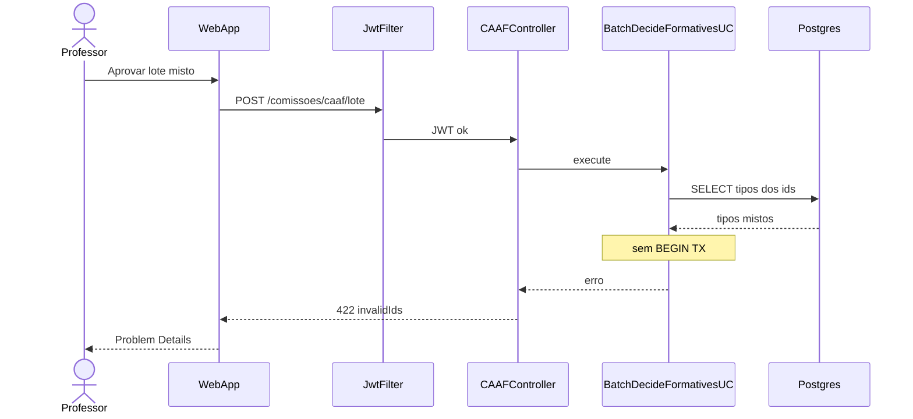

# F4.1f — 422 batch com tipos incompatíveis

| Campo | Valor |
|---|---|
| HU | US-F4-001 |
| Escopo | guard backend antes de TX — tipos mistos no lote |
| Atores | Professor, WebApp, JwtFilter, CAAFController, BatchDecideFormativesUC, Postgres |
| Pré-condições | payload com ≥ 1 item não elegível a lote (ex. comprovante) |
| Origem | `docs/tcc-docs.md` §8.5 · CA-05 · RN-F4.1-07 |

## Passos

1. POST batch com tipos mistos (bypass da UI).
2. UseCase valida **antes** do BEGIN TX → `422` + `invalidIds`.
3. Zero UPDATEs; UI normal já desabilita “Aprovar selecionados”.

## Mermaid

## Export

[`F4.1f-erro-422-lote.puml`](./F4.1f-erro-422-lote.puml)
