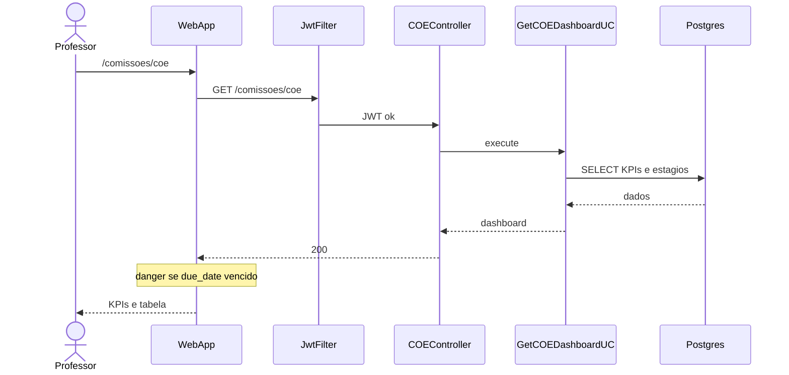

# F4.2a — Carregar pool COE

| Campo | Valor |
|---|---|
| HU | US-F4-002 |
| Escopo | KPIs + estágios (pool + atribuídos a mim); SLA no client |
| Atores | Professor, WebApp, JwtFilter, COEController, GetCOEDashboardUC, Postgres |
| Pré-condições | `internship.review`; COE ativo; estágios ≠ `CONCLUIDO` |
| Origem | `docs/tcc-docs.md` §8.5 · CA-01 · RN-F4.2-10 |

## Passos

1. Professor abre `/comissoes/coe`.
2. Backend retorna KPIs + lista; `document_due_date` do doc mais antigo sem parecer.
3. Client pinta danger se `document_due_date < now` (sem HTTP extra).

## Mermaid

## Export

[`F4.2a-carregar-pool-coe.puml`](./F4.2a-carregar-pool-coe.puml)
