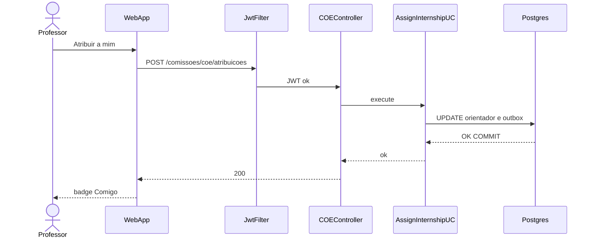

# F4.2b — Self-assign de estágio (notifica aluno)

| Campo | Valor |
|---|---|
| HU | US-F4-002 |
| Escopo | atribui a si + outbox ao aluno (diferença vs CAAF) |
| Atores | Professor, WebApp, JwtFilter, COEController, AssignInternshipUC, Postgres |
| Pré-condições | estágio sem orientador; `internship.review`; `_links.assign-member` |
| Origem | `docs/tcc-docs.md` §8.5 · CA-02 · RN-F4.2-05 |

## Passos

1. Professor clica “Atribuir a mim”.
2. TX: UPDATE orientador + `outbox_event`.
3. Dispatcher: filtra self; notifica **aluno** (“Seu orientador foi definido…”); item em `/estagios?to=me`.

## Mermaid

## Export

[`F4.2b-self-assign.puml`](./F4.2b-self-assign.puml)
