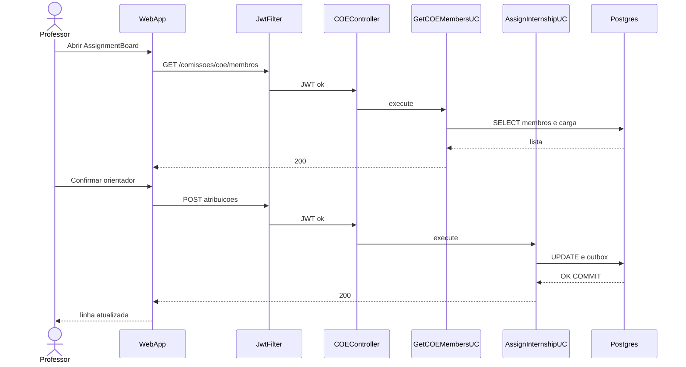

# F4.2c — Atribuir a outro orientador (AssignmentBoard)

| Campo | Valor |
|---|---|
| HU | US-F4-002 |
| Escopo | carga dos membros → atribui colega; notifica orientador + aluno |
| Atores | Professor, WebApp, JwtFilter, COEController, GetCOEMembersUC, AssignInternshipUC, Postgres |
| Pré-condições | estágio no pool ou comigo; ≥ 2 membros; `internship.review` |
| Origem | `docs/tcc-docs.md` §8.5 · CA-03 · RN-F4.2-02 |

## Passos

1. AssignmentBoard: carga = estágios ativos (`EM_ANDAMENTO` / `AGUARDANDO_DOC`).
2. TX: UPDATE assignee + outbox (payload orientador + aluno).
3. Item some do pool do originador.

## Mermaid

## Export

[`F4.2c-atribuir-orientador.puml`](./F4.2c-atribuir-orientador.puml)
