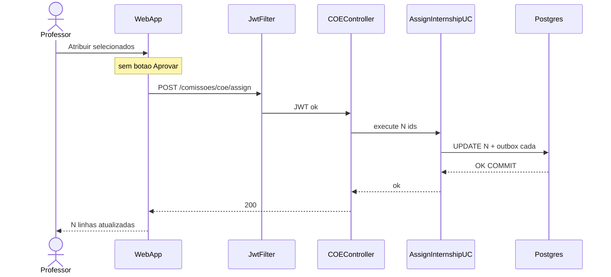

# F4.2d — Atribuição em lote (só Atribuir)

| Campo | Valor |
|---|---|
| HU | US-F4-002 |
| Escopo | BulkActionBar sem Aprovar; N estágios → 1 orientador |
| Atores | Professor, WebApp, JwtFilter, COEController, AssignInternshipUC, Postgres |
| Pré-condições | N estágios no mesmo COE; `internship.review` |
| Origem | `docs/tcc-docs.md` §8.5 · CA-04 · RN-F4.2-07 |

## Passos

1. BulkActionBar só “Atribuir selecionados” (parecer COE sempre individual).
2. `POST` com `internshipIds[]` + mesmo assignee.
3. TX: N UPDATEs + N `outbox_event` (fan-out por aluno).

## Mermaid

## Export

[`F4.2d-atribuicao-lote.puml`](./F4.2d-atribuicao-lote.puml)
