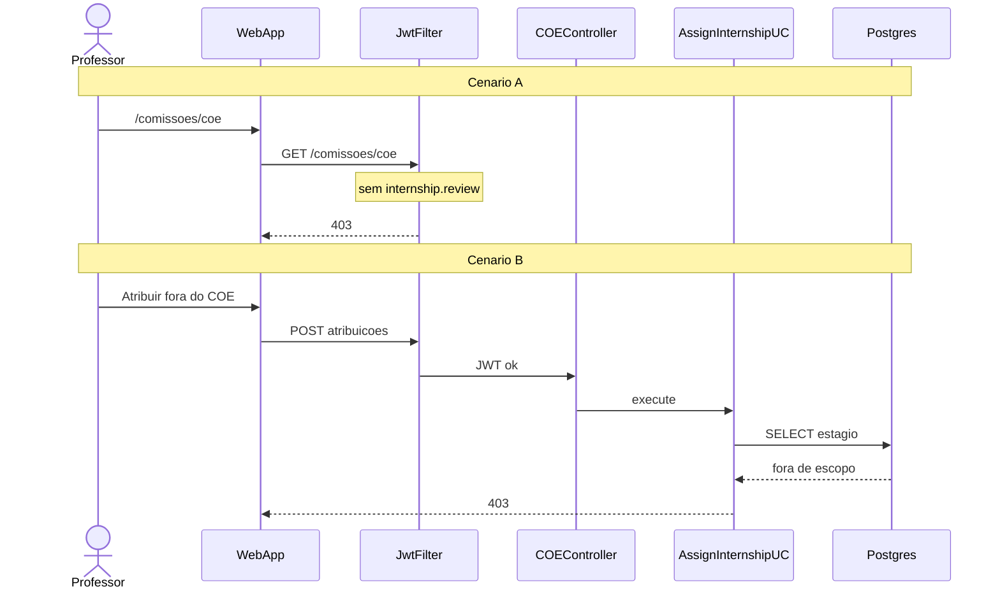

# F4.2e — 403 sem internship.review / escopo

| Campo | Valor |
|---|---|
| HU | US-F4-002 |
| Escopo | A: sem authority · B: estágio fora do COE/curso |
| Atores | Professor, WebApp, JwtFilter, COEController, AssignInternshipUC, Postgres |
| Pré-condições | A: sem `internship.review` · B: capability ok, escopo incompatível |
| Origem | `docs/tcc-docs.md` §8.5 · RN-F4.2 |

## Passos

1. **A:** `@PreAuthorize` → `403` antes da query.
2. **B:** UseCase valida escopo → `403` (mesmo padrão F4.1e).

## Mermaid

## Export

[`F4.2e-erro-403.puml`](./F4.2e-erro-403.puml)
