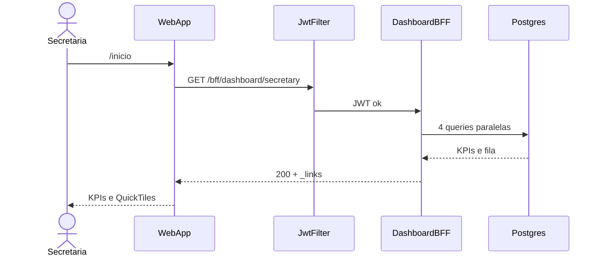

# F5.1-D01 — Dashboard da secretaria

| Campo | Valor |
|---|---|
| HU | US-F5-001 |
| Escopo | `GET /bff/dashboard/secretary` — cache MISS |
| Atores | Secretaria, WebApp, JwtFilter, DashboardBFF, Postgres |
| Pré-condições | `dashboard.view_secretary`; escopo via `CursoEscopoPort` |
| Origem | `docs/tcc-docs.md` §8.6 · CA-01 · RN-F5-001-03 |

## Passos

1. Secretaria abre `/inicio`.
2. BFF agrega 4 sub-queries em paralelo; fila ≤ 10 por `prazo_em`.
3. `alertasSla` / `sla_status` calculados no BFF; QuickTiles via `_links` + `useActions`.

## Mermaid

## Export

[`F5.1-D01-dashboard-secretaria.puml`](./F5.1-D01-dashboard-secretaria.puml)
