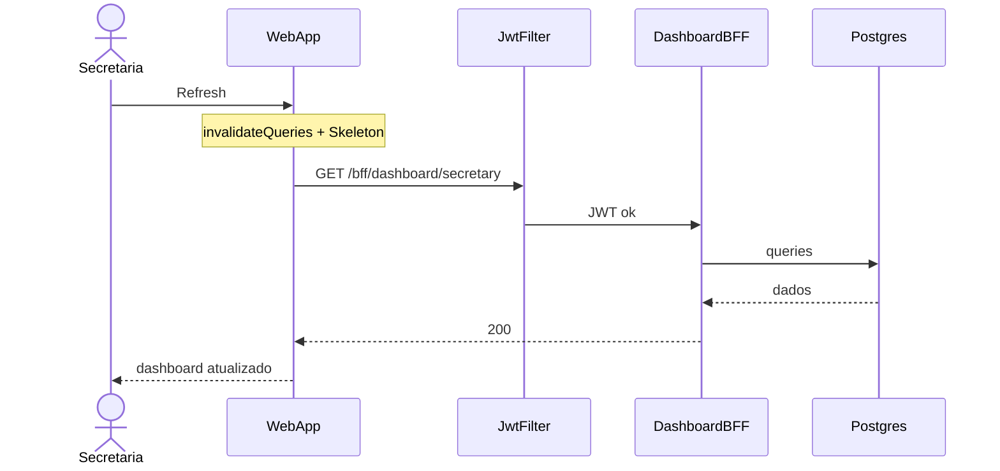

# F5.1-D02 — Refresh manual do dashboard

| Campo | Valor |
|---|---|
| HU | US-F5-001 |
| Escopo | `invalidateQueries` → novo GET ao BFF |
| Atores | Secretaria, WebApp, JwtFilter, DashboardBFF, Postgres |
| Pré-condições | dashboard em cache (`staleTime` 60 s) |
| Origem | `docs/tcc-docs.md` §8.6 · CA-05 |

## Passos

1. Secretaria clica Refresh.
2. TanStack invalida cache client-side; Skeleton enquanto `isLoading`.
3. Novo GET = mesmo fluxo de leitura de F5.1-D01 (sem Redis).

## Mermaid

## Export

[`F5.1-D02-refresh-manual.puml`](./F5.1-D02-refresh-manual.puml)
