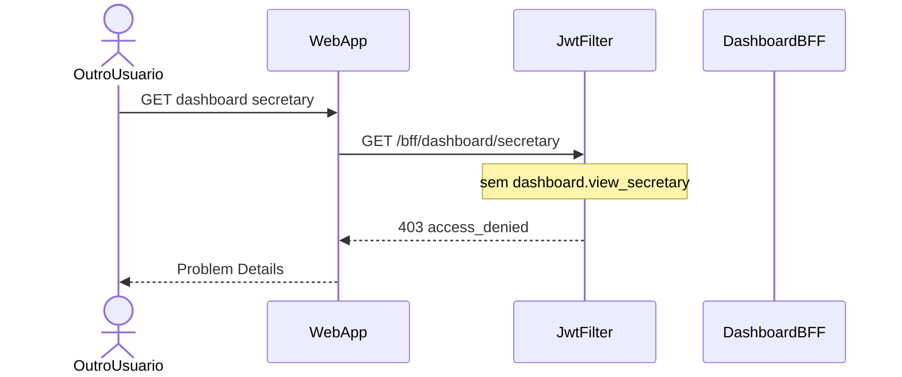

# F5.1-D03 — 403 sem dashboard.view_secretary

| Campo | Valor |
|---|---|
| HU | US-F5-001 |
| Escopo | usuário sem capability chama BFF da secretaria |
| Atores | OutroUsuario, WebApp, JwtFilter, DashboardBFF |
| Pré-condições | JWT válido; sem `dashboard.view_secretary` |
| Origem | `docs/tcc-docs.md` §8.6 · RN-F5-001 |

## Passos

1. Tentativa de `GET /bff/dashboard/secretary`.
2. `@PreAuthorize` → `403 access_denied` antes de query.
3. `/inicio` é universal: outros perfis usam o BFF do próprio dashboard (sem redirect 403).

## Mermaid

## Export

[`F5.1-D03-erro-403.puml`](./F5.1-D03-erro-403.puml)
