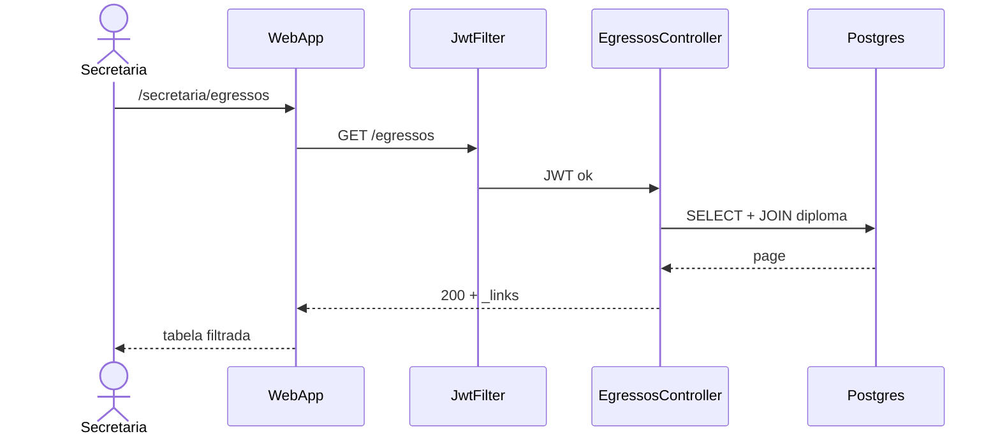

# F5.10-D01-EGRESSOS — Listar egressos

| Campo | Valor |
|---|---|
| HU | US-F5-005 |
| Escopo | `GET /egressos` paginado + filtros + `_links` por linha |
| Atores | Secretaria, WebApp, JwtFilter, EgressosController, Postgres |
| Pré-condições | `alumni.list` |
| Origem | `docs/tcc-docs.md` §8.6 · CA-01 · RN-F5-005-01 |

## Passos

1. Secretaria abre `/secretaria/egressos`.
2. Lista JOIN `graduation_record` (situação do diploma, data colação); page size 20.
3. `_links.confirm-delivery` só se diploma `PENDENTE`; CSV no critério (size 100, DRY F5.5).

## Mermaid

## Export

[`F5.10-D01-EGRESSOS-listar.puml`](./F5.10-D01-EGRESSOS-listar.puml)
