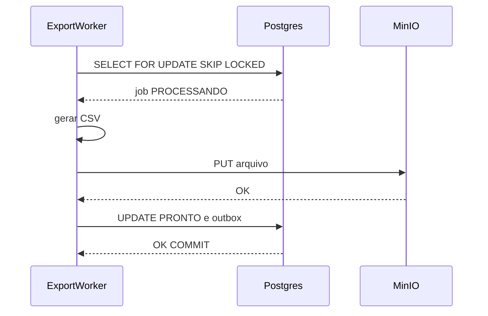

# F5.10-D02 — Worker gera CSV e publica

| Campo | Valor |
|---|---|
| HU | US-F5-010 |
| Escopo | ExportWorker: CSV → MinIO → job `PRONTO` + outbox |
| Atores | ExportWorker, Postgres, MinIO |
| Pré-condições | `export_job.status = PROCESSANDO` |
| Origem | `docs/tcc-docs.md` §8.6 · CA-02 |

## Passos

1. Worker pega job com `FOR UPDATE SKIP LOCKED`.
2. Gera CSV (memória/stream) → PUT MinIO.
3. TX: UPDATE `PRONTO` + `outbox_event` (`exports.ready`) → e-mail com link.

## Mermaid

## Export

[`F5.10-D02-worker-exportacao.puml`](./F5.10-D02-worker-exportacao.puml)
