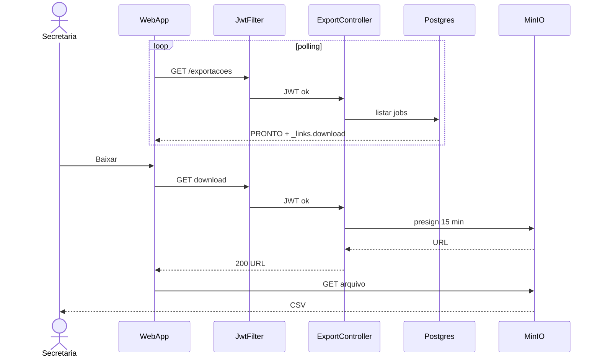

# F5.10-D03 — Polling PRONTO + download

| Campo | Valor |
|---|---|
| HU | US-F5-010 |
| Escopo | polling → Baixar via URL pré-assinada MinIO (15 min) |
| Atores | Secretaria, WebApp, JwtFilter, ExportController, Postgres, MinIO |
| Pré-condições | `export.run`; job passou a `PRONTO` |
| Origem | `docs/tcc-docs.md` §8.6 · CA-02 · RN-F5-010-06 |

## Passos

1. Polling a cada ~10 s até não haver `PROCESSANDO` (`aria-live="polite"`).
2. Clique Baixar → verifica `expiresAt`; senão `410`.
3. URL pré-assinada 15 min; arquivo no MinIO vive 7 dias (F5.10-D04).

## Mermaid

## Export

[`F5.10-D03-polling-download-exportacao.puml`](./F5.10-D03-polling-download-exportacao.puml)
