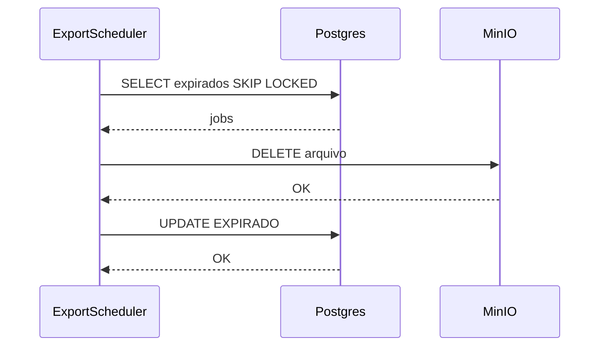

# F5.10-D04 — Scheduler expira exportação

| Campo | Valor |
|---|---|
| HU | US-F5-010 |
| Escopo | `expiresAt < now` → DELETE MinIO + status `EXPIRADO` |
| Atores | ExportScheduler, Postgres, MinIO |
| Pré-condições | job `PRONTO` com mais de 7 dias |
| Origem | `docs/tcc-docs.md` §8.6 · CA-03 · RN-F5-010-09 |

## Passos

1. Scheduler seleciona jobs expirados (`SKIP LOCKED`).
2. DELETE no MinIO; UPDATE `EXPIRADO` (registro permanece ~30 dias para auditoria).
3. `_links.download` some na listagem (HATEOAS).

## Mermaid

## Export

[`F5.10-D04-scheduler-expira-exportacao.puml`](./F5.10-D04-scheduler-expira-exportacao.puml)
