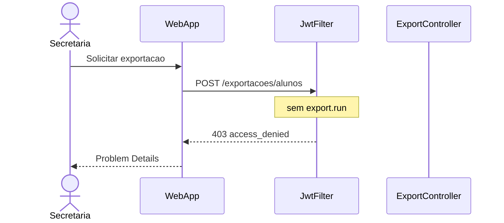

# F5.10-ERRO-403 — 403 sem export.run

| Campo | Valor |
|---|---|
| HU | US-F5-010 |
| Escopo | solicitar exportação sem capability |
| Atores | Secretaria, WebApp, JwtFilter, ExportController |
| Pré-condições | JWT válido; `export.run` ausente |
| Origem | `docs/tcc-docs.md` §8.6 |

## Passos

1. Tentativa de `POST /exportacoes/{kind}`.
2. JwtFilter → `403 access_denied`.

## Mermaid

## Export

[`F5.10-ERRO-403-sem-export-run.puml`](./F5.10-ERRO-403-sem-export-run.puml)
