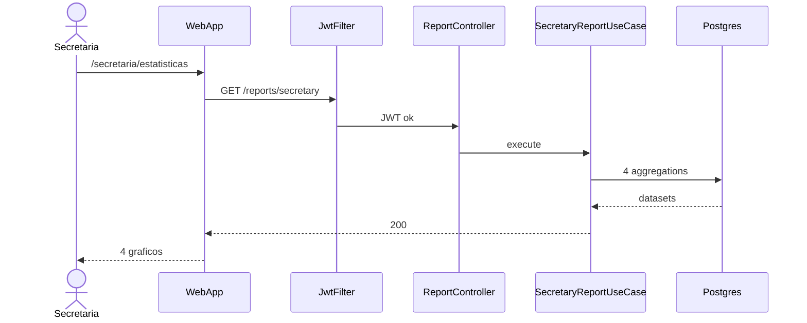

# F5.11-D01 — Relatórios da secretaria (cache MISS)

| Campo | Valor |
|---|---|
| HU | US-F5-011 |
| Escopo | `GET /reports/secretary` — 4 datasets agregados |
| Atores | Secretaria, WebApp, JwtFilter, ReportController, SecretaryReportUseCase, Postgres |
| Pré-condições | `report.view_secretary`; cache TanStack ausente/expirado |
| Origem | `docs/tcc-docs.md` §8.6 · CA-01 · RN-F5-011-02 |

## Passos

1. Abre `/secretaria/estatisticas` com filtros da URL.
2. UseCase agrega 4 queries (paralelo/CTE); `cursoId` null = todos os cursos vinculados.
3. Cache client `staleTime=5min`; drill-down só no client (sem HTTP).

## Mermaid

## Export

[`F5.11-D01-relatorios-secretaria.puml`](./F5.11-D01-relatorios-secretaria.puml)
