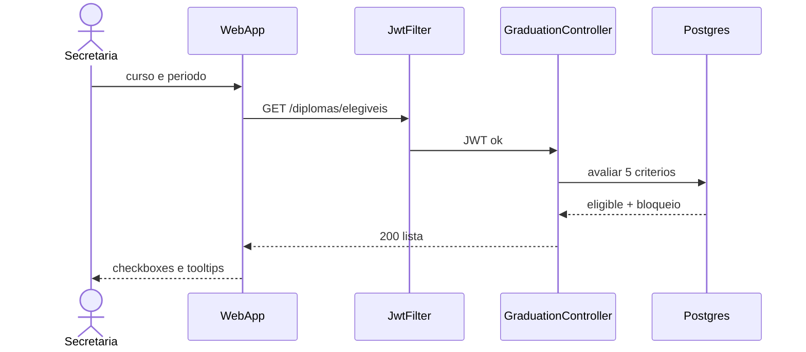

# F5.11-D02-ELEGIVEIS — Buscar elegíveis para colação

| Campo | Valor |
|---|---|
| HU | US-F5-005 |
| Escopo | `GET /diplomas/elegiveis` — 5 critérios por aluno |
| Atores | Secretaria, WebApp, JwtFilter, GraduationController, Postgres |
| Pré-condições | `diploma.register`; curso e período selecionados |
| Origem | `docs/tcc-docs.md` §8.6 · CA-02 · CA-04 · RN-F5-005-07 |

## Passos

1. Wizard Passo 1: curso + período.
2. Backend avalia elegibilidade (TCC, disciplinas, horas formativas, financeiras, solicitações).
3. `eligible: false` → checkbox desabilitado + tooltip com `bloqueio.razao` (sem HTTP extra).

## Mermaid

## Export

[`F5.11-D02-ELEGIVEIS-buscar.puml`](./F5.11-D02-ELEGIVEIS-buscar.puml)
