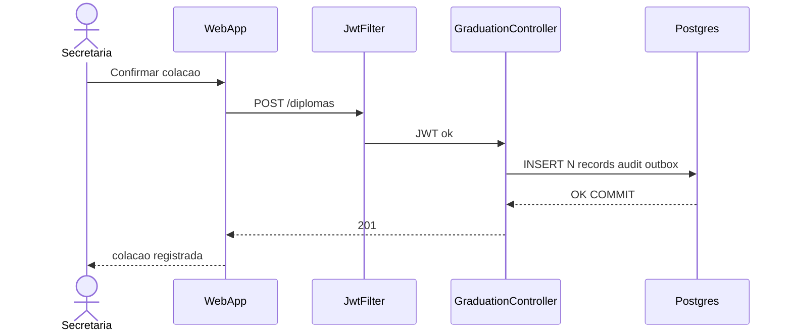

# F5.11-D03 — Confirmar colação em lote

| Campo | Valor |
|---|---|
| HU | US-F5-005 |
| Escopo | `POST /diplomas` + TX `graduation_record` × N + outbox × N |
| Atores | Secretaria, WebApp, JwtFilter, GraduationController, Postgres |
| Pré-condições | `diploma.register`; ≥ 1 elegível; dados da cerimônia |
| Origem | `docs/tcc-docs.md` §8.6 · CA-03 · RN-F5-005-09 |

## Passos

1. Passo 2: data, livro, folha → Confirmar colação.
2. TX única: N `graduation_record` + `audit_log` + `outbox_event` (`egressos.graduated`) por aluno.
3. **Não** grava `role = EGRESSO` (CA-03); authorities via FGAC/`_links` (4.11). E-mail de boas-vindas via Outbox.

## Mermaid

## Export

[`F5.11-D03-confirmar-colacao.puml`](./F5.11-D03-confirmar-colacao.puml)
