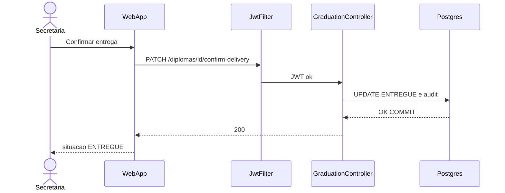

# F5.11-D04 — Confirmar entrega física do diploma

| Campo | Valor |
|---|---|
| HU | US-F5-005 |
| Escopo | `PATCH .../confirm-delivery` → `ENTREGUE` + audit |
| Atores | Secretaria, WebApp, JwtFilter, GraduationController, Postgres |
| Pré-condições | `diploma.register`; diploma `PENDENTE`; `_links.confirm-delivery` |
| Origem | `docs/tcc-docs.md` §8.6 · CA-05 · RN-F5-005-11 |

## Passos

1. Secretaria confirma método (`PRESENCIAL` / `PROCURACAO` / `CORREIO`) e data.
2. UPDATE `situacao_diploma=ENTREGUE` + `audit_log` (evidência formal).
3. `_links`: remove `confirm-delivery`, mantém `view`.

## Mermaid

## Export

[`F5.11-D04-confirmar-entrega.puml`](./F5.11-D04-confirmar-entrega.puml)
