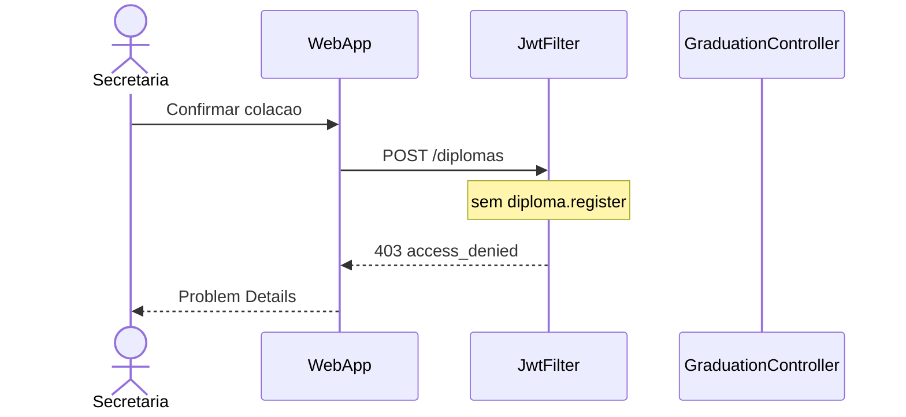

# F5.11-ERRO-01 — 403 sem diploma.register

| Campo | Valor |
|---|---|
| HU | US-F5-005 |
| Escopo | tem `alumni.list`, tenta confirmar colação sem `diploma.register` |
| Atores | Secretaria, WebApp, JwtFilter, GraduationController |
| Pré-condições | JWT com `alumni.list`; sem `diploma.register` |
| Origem | `docs/tcc-docs.md` §8.6 · RN-F5-005-06 |

## Passos

1. POST/confirmação direta (botão normalmente oculto via HATEOAS).
2. `@PreAuthorize` → `403 access_denied` antes de query.
3. Padrão idêntico a F5.6-ERRO-03 (DRY).

## Mermaid

## Export

[`F5.11-ERRO-01-sem-diploma-register.puml`](./F5.11-ERRO-01-sem-diploma-register.puml)
