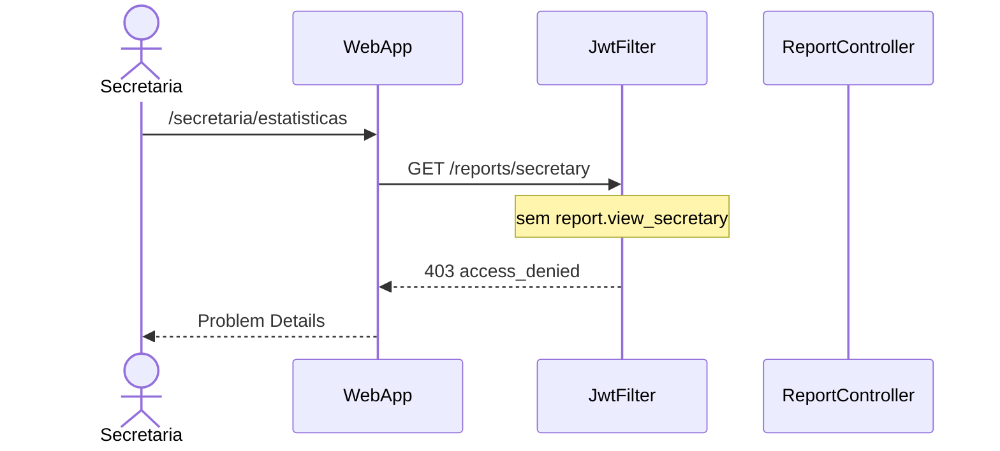

# F5.11-ERRO-403 — 403 sem report.view_secretary

| Campo | Valor |
|---|---|
| HU | US-F5-011 |
| Escopo | acesso a estatísticas sem capability |
| Atores | Secretaria, WebApp, JwtFilter, ReportController |
| Pré-condições | JWT válido; `report.view_secretary` ausente |
| Origem | `docs/tcc-docs.md` §8.6 |

## Passos

1. Tentativa de `GET /reports/secretary`.
2. JwtFilter → `403 access_denied`.

## Mermaid

## Export

[`F5.11-ERRO-403-sem-report-view.puml`](./F5.11-ERRO-403-sem-report-view.puml)
