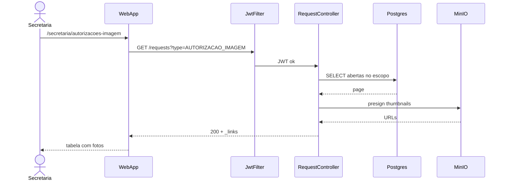

# F5.12-D01 — Listar autorizações com thumbnails

| Campo | Valor |
|---|---|
| HU | US-F5-006 |
| Escopo | lista compacta + URLs pré-assinadas MinIO (15 min) |
| Atores | Secretaria, WebApp, JwtFilter, RequestController, Postgres, MinIO |
| Pré-condições | `image_authorization.review`; tipo `AUTORIZACAO_IMAGEM` / `ABERTA` |
| Origem | `docs/tcc-docs.md` §8.6 · CA-01 · RN-F5-006-03 |

## Passos

1. Secretaria abre `/secretaria/autorizacoes-imagem`.
2. Backend filtra tipo + escopo de cursos; gera thumbnails presigned em batch (TTL 15 min).
3. Sem foto → `thumbnail_url` null (placeholder); `_links.bulk_deliberate` só se `ABERTA`.

## Mermaid

## Export

[`F5.12-D01-listar-autorizacoes-imagem.puml`](./F5.12-D01-listar-autorizacoes-imagem.puml)
