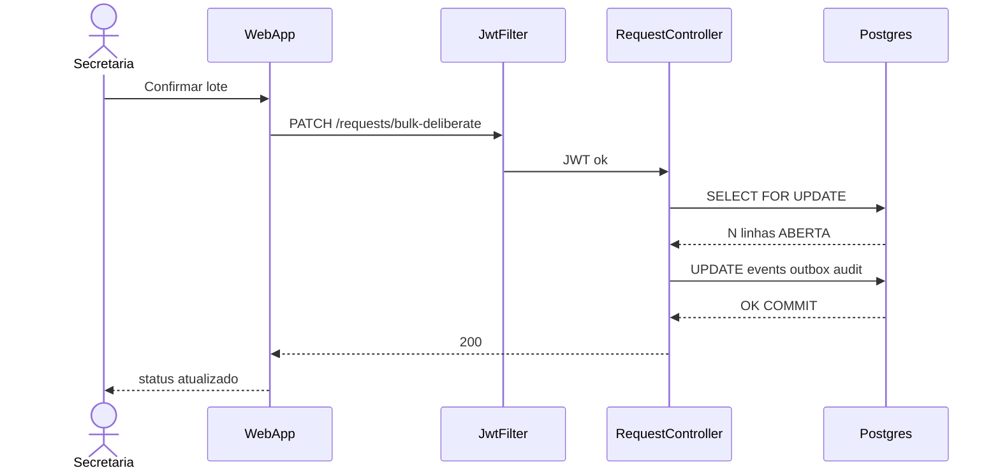

# F5.12-D02 — Aprovar ou rejeitar em lote

| Campo | Valor |
|---|---|
| HU | US-F5-006 |
| Escopo | `PATCH /requests/bulk-deliberate` + FOR UPDATE + TX + outbox × N |
| Atores | Secretaria, WebApp, JwtFilter, RequestController, Postgres |
| Pré-condições | N itens com `_links.bulk_deliberate`; estado `ABERTA` |
| Origem | `docs/tcc-docs.md` §8.6 · CA-02 · CA-05 · RN-F5-006-06 |

## Passos

1. Confirma dialog (DEFERIDA ou INDEFERIDA + justificativa opcional).
2. `SELECT … FOR UPDATE`; count ≠ N → F5.12-ERRO-01.
3. TX única: UPDATE + `request_event` + `outbox_event` + `audit_log` por item.

## Mermaid

## Export

[`F5.12-D02-bulk-deliberate.puml`](./F5.12-D02-bulk-deliberate.puml)
