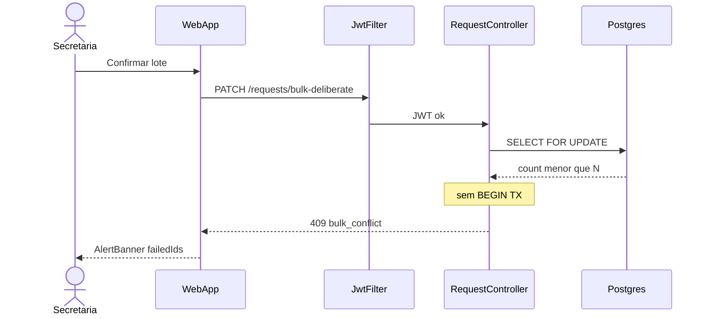

# F5.12-ERRO-01 — 409 falha parcial por concorrência

| Campo | Valor |
|---|---|
| HU | US-F5-006 |
| Escopo | algum ID deixou de estar `ABERTA` — zero mutações |
| Atores | Secretaria, WebApp, JwtFilter, RequestController, Postgres |
| Pré-condições | estado mudou entre listagem e PATCH |
| Origem | `docs/tcc-docs.md` §8.6 · CA-03 · RN-F5-006-06 |

## Passos

1. `SELECT FOR UPDATE` retorna count &lt; N.
2. Sem abrir TX → `409 bulk_conflict` + `failedIds[]`.
3. UI: AlertBanner + `invalidateQueries` para refazer seleção.

## Mermaid

## Export

[`F5.12-ERRO-01-bulk-conflict.puml`](./F5.12-ERRO-01-bulk-conflict.puml)
