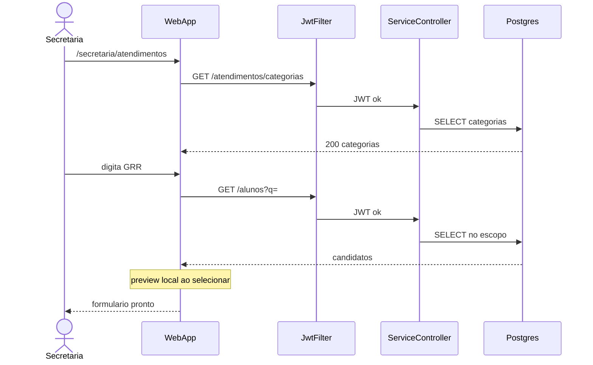

# F5.13-D01 — Carregar formulário de atendimento

| Campo | Valor |
|---|---|
| HU | US-F5-007 |
| Escopo | categorias + Combobox aluno (debounce) |
| Atores | Secretaria, WebApp, JwtFilter, ServiceController, Postgres |
| Pré-condições | `service_record.create` |
| Origem | `docs/tcc-docs.md` §8.6 · CA-01 · RN-F5-007-03 |

## Passos

1. Montagem: `GET /atendimentos/categorias` (`staleTime` longo).
2. Digita no Combobox → busca com debounce 300 ms (DRY F5.3-D02).
3. Seleciona aluno → preview de notificação só no React state (sem HTTP).

## Mermaid

## Export

[`F5.13-D01-carregar-formulario-atendimento.puml`](./F5.13-D01-carregar-formulario-atendimento.puml)
