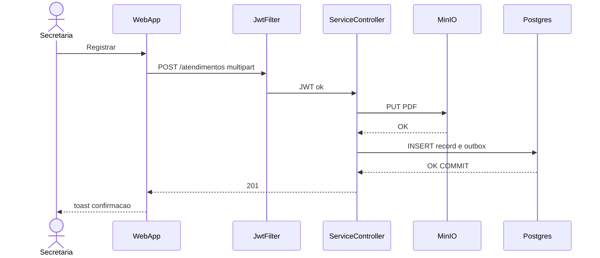

# F5.13-D02 — Registrar atendimento com anexo

| Campo | Valor |
|---|---|
| HU | US-F5-007 |
| Escopo | `POST /atendimentos` multipart + TX + outbox |
| Atores | Secretaria, WebApp, JwtFilter, ServiceController, MinIO, Postgres |
| Pré-condições | `service_record.create`; PDF ≤ 10 MB (client) |
| Origem | `docs/tcc-docs.md` §8.6 · CA-02 · CA-03 |

## Passos

1. Secretaria confirma; PDF vai no **corpo** multipart (não `anexoUrl`).
2. Persistência do arquivo (MinIO) + TX: `service_record` + `outbox_event` (`atendimento.registrado`).
3. Sem anexo: mesmo fluxo sem PDF (DRY, sem diagrama separado).

## Mermaid

## Export

[`F5.13-D02-registrar-atendimento.puml`](./F5.13-D02-registrar-atendimento.puml)
