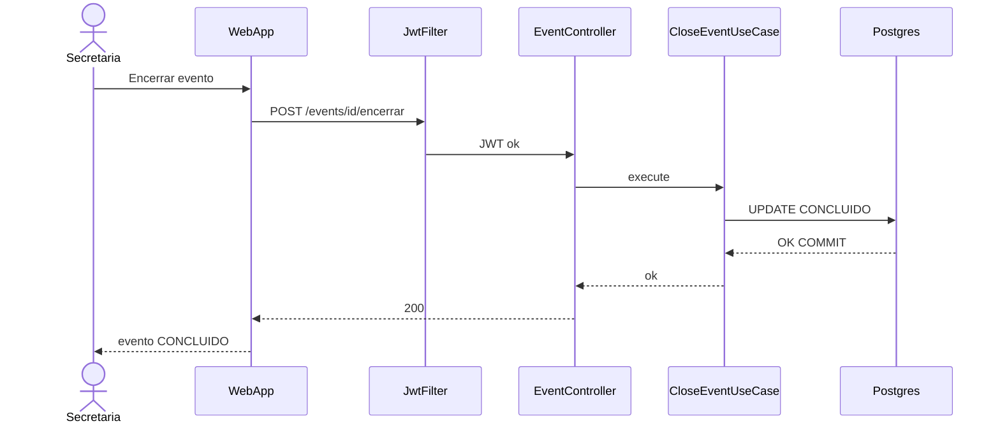

# F5.14-D02 — Encerrar evento

| Campo | Valor |
|---|---|
| HU | US-F5-008 |
| Escopo | `POST /events/{id}/encerrar` → `CONCLUIDO` |
| Atores | Secretaria, WebApp, JwtFilter, EventController, CloseEventUseCase, Postgres |
| Pré-condições | `event.host`; `EM_ANDAMENTO`; `_links.encerrar-evento` |
| Origem | `docs/tcc-docs.md` §8.6 · CA-04 |

## Passos

1. Secretaria confirma encerramento.
2. TX: estado → `CONCLUIDO`.
3. **CA-04:** neste passo **não** nasce `formative_entry` nem certificado (slot antigo citava isso; prevalece o critério).

## Mermaid

## Export

[`F5.14-D02-encerrar-evento.puml`](./F5.14-D02-encerrar-evento.puml)
