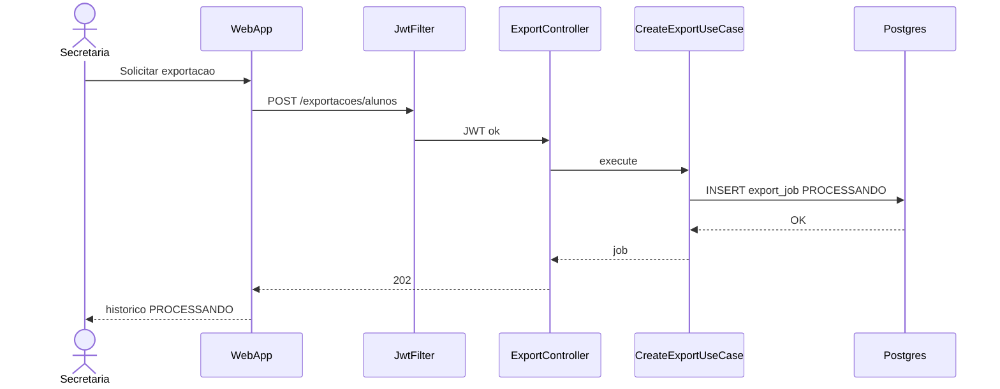

# F5.17-D01 — Solicitar exportação

| Campo | Valor |
|---|---|
| HU | US-F5-010 |
| Escopo | `POST /exportacoes/{kind}` → `202` + job `PROCESSANDO` |
| Atores | Secretaria, WebApp, JwtFilter, ExportController, CreateExportUseCase, Postgres |
| Pré-condições | `export.run`; filtros informados |
| Origem | `docs/tcc-docs.md` §8.6 · CA-01 · RN-F5-010-04 |

## Passos

1. Secretaria confirma kind + filtros.
2. UseCase só cria `export_job` (`PROCESSANDO`) — geração fica no worker (F5.10-D02).
3. UI não bloqueia; badge PROCESSANDO + polling 10 s (F5.10-D03).

## Mermaid

## Export

[`F5.17-D01-solicitar-exportacao.puml`](./F5.17-D01-solicitar-exportacao.puml)
