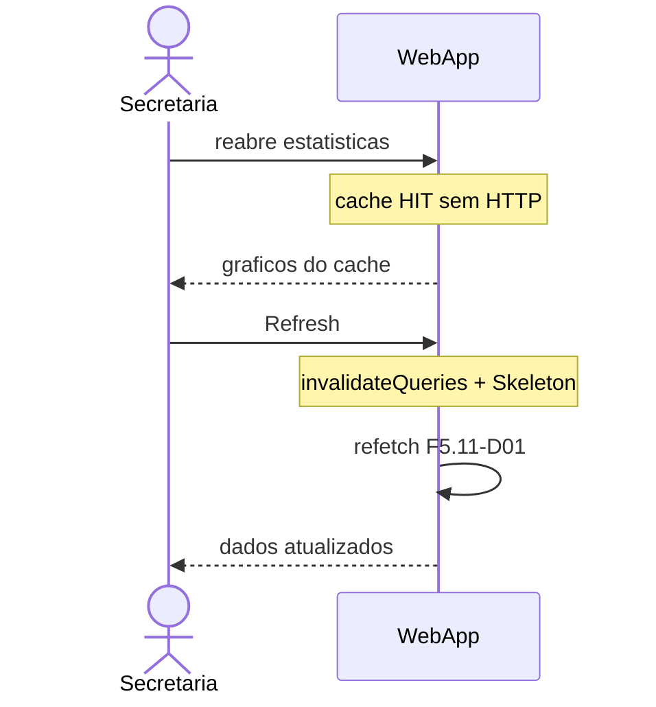

# F5.18-D02 — Cache HIT + refresh manual

| Campo | Valor |
|---|---|
| HU | US-F5-011 |
| Escopo | TanStack serve cache (&lt; 5 min) ou invalidate → refetch |
| Atores | Secretaria, WebApp |
| Pré-condições | cache presente e fresco |
| Origem | `docs/tcc-docs.md` §8.6 · RN-F5-011-08 |

## Passos

1. Retorno à tela dentro de 5 min → sem HTTP.
2. Refresh: `invalidateQueries` → Skeleton + novo GET (F5.11-D01).

## Mermaid

## Export

[`F5.18-D02-cache-refresh-relatorios.puml`](./F5.18-D02-cache-refresh-relatorios.puml)
