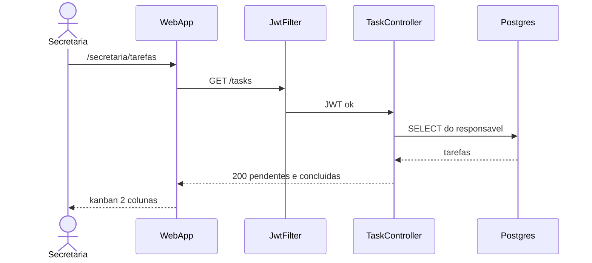

# F5.19-D01 — Carregar kanban

| Campo | Valor |
|---|---|
| HU | US-F5-012 |
| Escopo | `GET /tasks` → colunas Pendente / Concluída |
| Atores | Secretaria, WebApp, JwtFilter, TaskController, Postgres |
| Pré-condições | `task.manage`; `tasks.enabled=true` |
| Origem | `docs/tcc-docs.md` §8.6 · CA-02 |

## Passos

1. Secretaria abre `/secretaria/tarefas`.
2. Backend lista tarefas do `responsavel_id`; DTO particiona `pendentes[]` / `concluidas[]`.
3. `_links.criar` se `task.manage`; vencido → danger no client.

## Mermaid

## Export

[`F5.19-D01-carregar-kanban.puml`](./F5.19-D01-carregar-kanban.puml)
