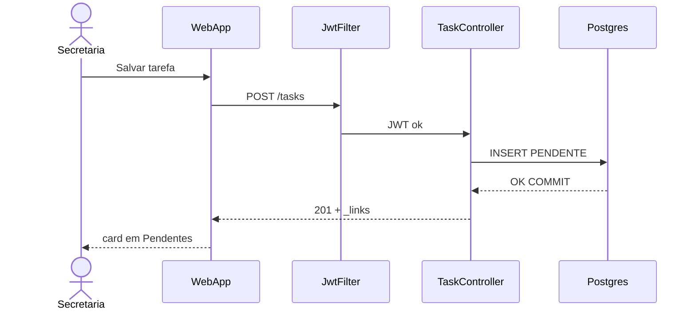

# F5.19-D02 — Criar tarefa

| Campo | Valor |
|---|---|
| HU | US-F5-012 |
| Escopo | `POST /tasks` → card em Pendentes |
| Atores | Secretaria, WebApp, JwtFilter, TaskController, Postgres |
| Pré-condições | `task.manage`; título 1–200 chars |
| Origem | `docs/tcc-docs.md` §8.6 · CA-02 · RN-F5-012-08 |

## Passos

1. Secretaria salva “Nova tarefa”.
2. TX: INSERT com `estado=PENDENTE` (nunca do body); **sem** outbox.
3. `_links.excluir` só enquanto `PENDENTE`.

## Mermaid

## Export

[`F5.19-D02-criar-tarefa.puml`](./F5.19-D02-criar-tarefa.puml)
