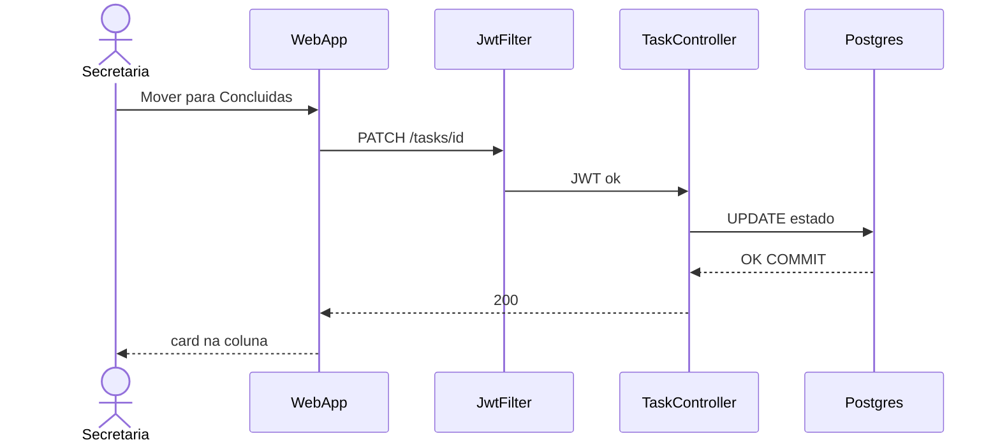

# F5.19-D03 — Atualizar estado da tarefa

| Campo | Valor |
|---|---|
| HU | US-F5-012 |
| Escopo | `PATCH /tasks/:id` — drag ou teclado (mesma API) |
| Atores | Secretaria, WebApp, JwtFilter, TaskController, Postgres |
| Pré-condições | `task.manage`; tarefa do responsável |
| Origem | `docs/tcc-docs.md` §8.6 · CA-03 · CA-04 |

## Passos

1. Drag para Concluídas **ou** botão Concluir (Tab/Enter) → mesmo PATCH.
2. UPDATE `estado` (`CONCLUIDA` / `PENDENTE` para reabrir).
3. `CONCLUIDA` omite `_links.excluir`.

## Mermaid

## Export

[`F5.19-D03-atualizar-estado.puml`](./F5.19-D03-atualizar-estado.puml)
