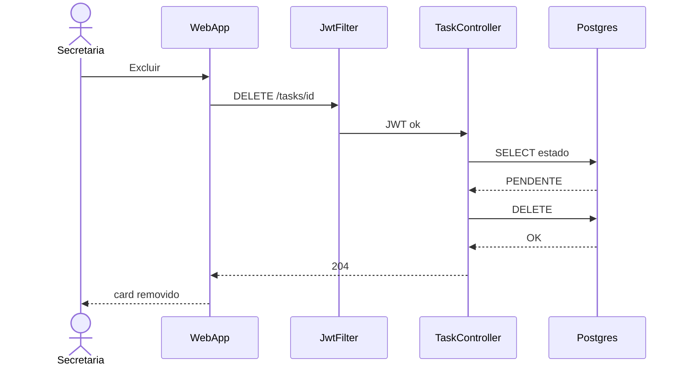

# F5.19-D04 — Excluir tarefa

| Campo | Valor |
|---|---|
| HU | US-F5-012 |
| Escopo | `DELETE /tasks/:id` só se `PENDENTE` |
| Atores | Secretaria, WebApp, JwtFilter, TaskController, Postgres |
| Pré-condições | `task.manage`; `_links.excluir`; estado `PENDENTE` |
| Origem | `docs/tcc-docs.md` §8.6 |

## Passos

1. Secretaria exclui card pendente.
2. Guard: `CONCLUIDA` → F5.19-ERRO-04 (`409`).
3. DELETE hard (sem soft-delete no MVP).

## Mermaid

## Export

[`F5.19-D04-excluir-tarefa.puml`](./F5.19-D04-excluir-tarefa.puml)
