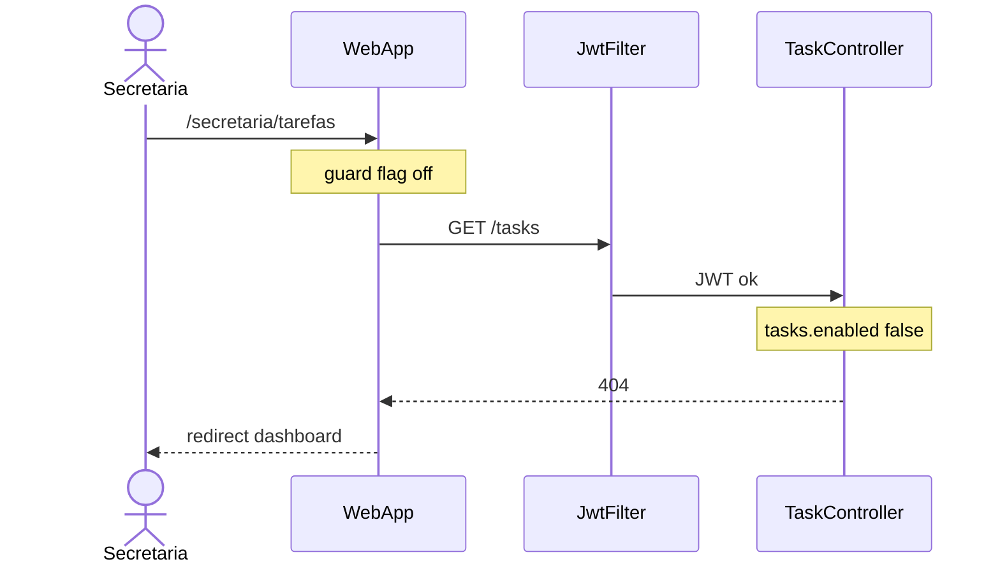

# F5.19-ERRO-01 — Feature flag desativada (404)

| Campo | Valor |
|---|---|
| HU | US-F5-012 |
| Escopo | `tasks.enabled=false` → 404 / redirect |
| Atores | Secretaria, WebApp, JwtFilter, TaskController |
| Pré-condições | flag off |
| Origem | `docs/tcc-docs.md` §8.6 · CA-01 · RN-F5-012-01 |

## Passos

1. Guard de rota + menu oculto (primeira barreira).
2. Chamada direta à API → backend `404`.
3. Sem `_links` de Tarefas no dashboard BFF.

## Mermaid

## Export

[`F5.19-ERRO-01-feature-flag.puml`](./F5.19-ERRO-01-feature-flag.puml)
