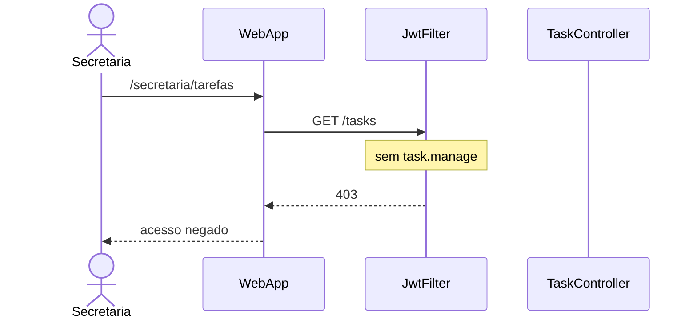

# F5.19-ERRO-02 — 403 sem task.manage

| Campo | Valor |
|---|---|
| HU | US-F5-012 |
| Escopo | qualquer `/tasks` sem capability |
| Atores | Secretaria, WebApp, JwtFilter, TaskController |
| Pré-condições | JWT válido; `task.manage` ausente |
| Origem | `docs/tcc-docs.md` §8.6 · RN-F5-012-02 |

## Passos

1. Tentativa de GET/POST/PATCH/DELETE.
2. `@PreAuthorize` → `403` antes do UseCase.

## Mermaid

## Export

[`F5.19-ERRO-02-sem-task-manage.puml`](./F5.19-ERRO-02-sem-task-manage.puml)
