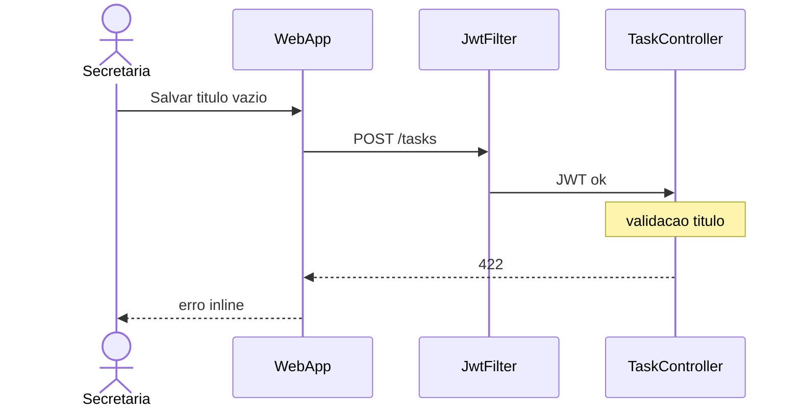

# F5.19-ERRO-03 — 422 título inválido

| Campo | Valor |
|---|---|
| HU | US-F5-012 |
| Escopo | título vazio ou &gt; 200 chars |
| Atores | Secretaria, WebApp, JwtFilter, TaskController |
| Pré-condições | `task.manage`; payload inválido |
| Origem | `docs/tcc-docs.md` §8.6 · RN-F5-012-03 |

## Passos

1. Zod no client normalmente bloqueia; bypass → POST.
2. Bean Validation / UseCase → `422` Problem Details.
3. Erro inline no campo título.

## Mermaid

## Export

[`F5.19-ERRO-03-titulo-invalido.puml`](./F5.19-ERRO-03-titulo-invalido.puml)
