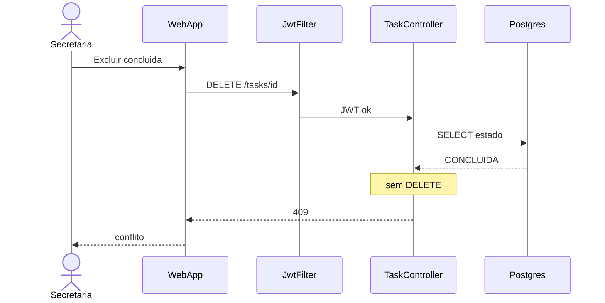

# F5.19-ERRO-04 — 409 DELETE tarefa CONCLUIDA

| Campo | Valor |
|---|---|
| HU | US-F5-012 |
| Escopo | exclusão bloqueada se estado `CONCLUIDA` |
| Atores | Secretaria, WebApp, JwtFilter, TaskController, Postgres |
| Pré-condições | tarefa concluída; chamada direta (UI oculta `_links.excluir`) |
| Origem | `docs/tcc-docs.md` §8.6 |

## Passos

1. DELETE em tarefa `CONCLUIDA`.
2. Guard de negócio → `409` (sem DELETE).
3. Para excluir: reabrir (`PATCH PENDENTE`) e então DELETE.

## Mermaid

## Export

[`F5.19-ERRO-04-delete-concluida.puml`](./F5.19-ERRO-04-delete-concluida.puml)
