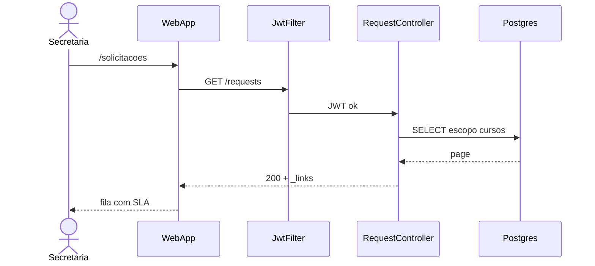

# F5.2-D01 — Fila de solicitações

| Campo | Valor |
|---|---|
| HU | US-F5-002 |
| Escopo | lista paginada + filtros + `_links` por linha |
| Atores | Secretaria, WebApp, JwtFilter, RequestController, Postgres |
| Pré-condições | `request.view_curso`; filtros padrão `ABERTA` / `prazo_em` |
| Origem | `docs/tcc-docs.md` §8.6 · CA-01 · RN-F5-002-01 |

## Passos

1. Secretaria abre `/solicitacoes`.
2. Backend filtra por cursos vinculados; `sla_status` na resposta.
3. Ações (`deliberate`, `assign`…) só via `_links` HATEOAS.

## Mermaid

## Export

[`F5.2-D01-fila-solicitacoes.puml`](./F5.2-D01-fila-solicitacoes.puml)
