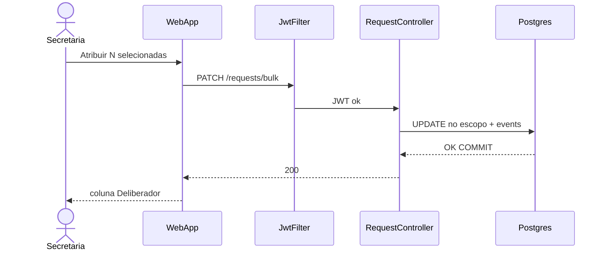

# F5.2-D04 — Atribuir deliberador em massa

| Campo | Valor |
|---|---|
| HU | US-F5-002 |
| Escopo | `PATCH /requests/bulk` — só linhas com `_links.bulk_assign` |
| Atores | Secretaria, WebApp, JwtFilter, RequestController, Postgres |
| Pré-condições | `request.deliberate`; deliberador selecionado |
| Origem | `docs/tcc-docs.md` §8.6 · CA-04 · RN-F5-002-08 |

## Passos

1. BulkActionBar só nas linhas com `bulk_assign`.
2. Backend revalida `id IN (...) AND curso_id IN cursoIds[]`.
3. TX: UPDATE deliberador + `request_event` por item; **sem** outbox ao aluno.

## Mermaid

## Export

[`F5.2-D04-atribuir-deliberador.puml`](./F5.2-D04-atribuir-deliberador.puml)
