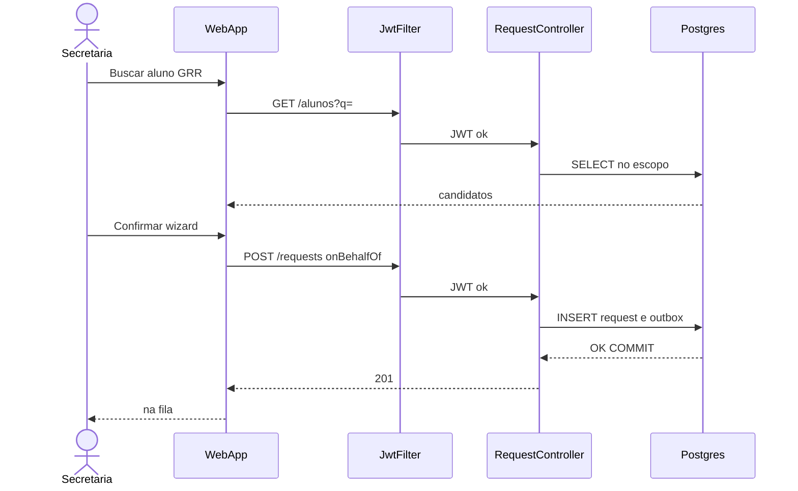

# F5.3-D02 — Nova interna em nome de aluno

| Campo | Valor |
|---|---|
| HU | US-F5-002 |
| Escopo | Combobox aluno + wizard F1.8 + `onBehalfOf` + TX/outbox |
| Atores | Secretaria, WebApp, JwtFilter, RequestController, Postgres |
| Pré-condições | `request.internal_open`; aluno no curso da secretaria |
| Origem | `docs/tcc-docs.md` §8.6 · CA-02 · RN-F5-002-05 |

## Passos

1. Busca aluno (GRR / trigrama) restrita ao escopo de cursos.
2. Wizard reutiliza F1.8; POST com `onBehalfOf`.
3. TX: INSERT request + `outbox_event`; aluno titular notificado.

## Mermaid

## Export

[`F5.3-D02-nova-interna.puml`](./F5.3-D02-nova-interna.puml)
