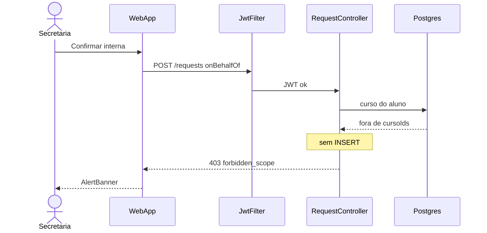

# F5.3-ERRO — 403 nova interna fora do escopo

| Campo | Valor |
|---|---|
| HU | US-F5-002 |
| Escopo | `onBehalfOf` de aluno cujo curso não está vinculado |
| Atores | Secretaria, WebApp, JwtFilter, RequestController, Postgres |
| Pré-condições | `request.internal_open`; aluno fora de `cursoIds[]` |
| Origem | `docs/tcc-docs.md` §8.6 · RN-F5-002-06 |

## Passos

1. POST com `onBehalfOf` fora do escopo.
2. Validação **antes** do INSERT → `403 forbidden_scope`.
3. AlertBanner no wizard; Combobox permanece editável.

## Mermaid

## Export

[`F5.3-ERRO-aluno-fora-escopo.puml`](./F5.3-ERRO-aluno-fora-escopo.puml)
