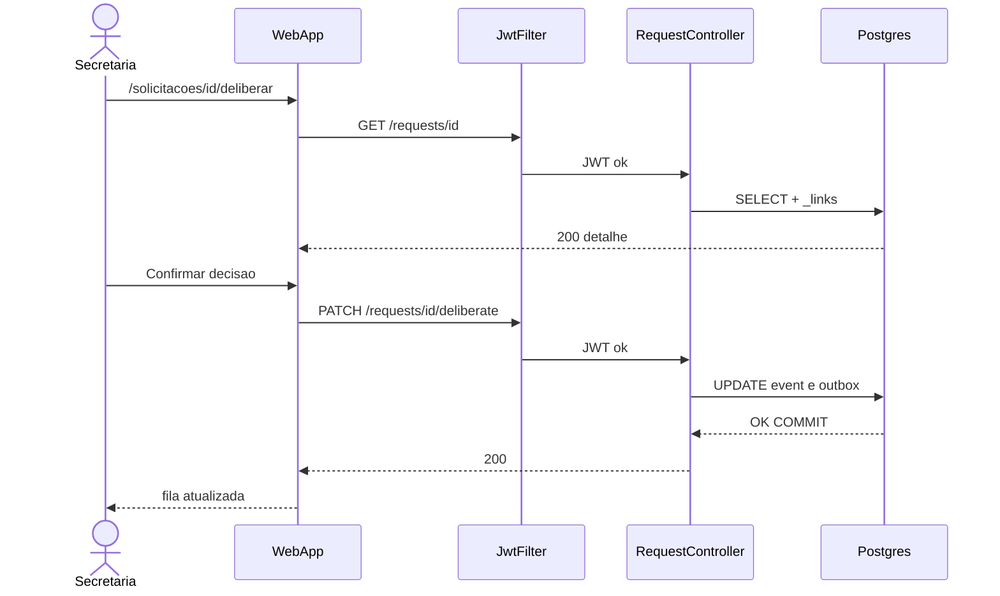

# F5.4-D03 — Deliberar sem deep-link

| Campo | Valor |
|---|---|
| HU | US-F5-002 |
| Escopo | GET detalhe + PATCH deliberação + TX/outbox (sem JWT e-mail) |
| Atores | Secretaria, WebApp, JwtFilter, RequestController, Postgres |
| Pré-condições | `request.deliberate`; `_links.deliberate`; sem exigir `senior_secretary` |
| Origem | `docs/tcc-docs.md` §8.6 · CA-03 · RN-F5-002-07 |

## Passos

1. Abre `/solicitacoes/:id/deliberar` pela fila (sem token de e-mail).
2. GET retorna `_links` de ações; PATCH aplica decisão.
3. TX: UPDATE + `request_event` + `outbox_event`; aluno notificado.

## Mermaid

## Export

[`F5.4-D03-deliberar-sem-deeplink.puml`](./F5.4-D03-deliberar-sem-deeplink.puml)
