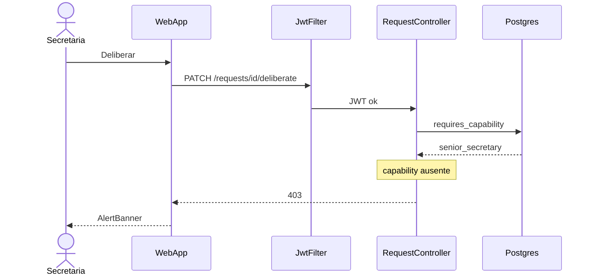

# F5.4-ERRO — 403 deliberar sem senior_secretary

| Campo | Valor |
|---|---|
| HU | US-F5-002 |
| Escopo | RequestType exige `senior_secretary` ausente no JWT |
| Atores | Secretaria, WebApp, JwtFilter, RequestController, Postgres |
| Pré-condições | `request.deliberate` ok; sem `senior_secretary` |
| Origem | `docs/tcc-docs.md` §8.6 · RN-F5-002-07 |

## Passos

1. Tentativa de deliberar tipo que exige secretário sênior.
2. Controller consulta `requires_capability` → bloqueia antes da mutação.
3. Idealmente `_links.deliberate` já estaria ausente (defesa HATEOAS + backend).

## Mermaid

## Export

[`F5.4-ERRO-senior-secretary.puml`](./F5.4-ERRO-senior-secretary.puml)
