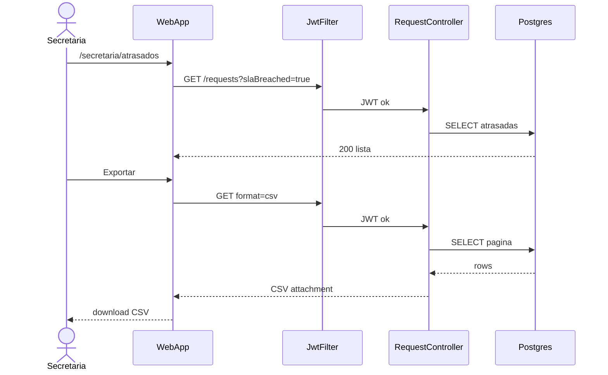

# F5.5-D05 — Atrasados com exportação CSV

| Campo | Valor |
|---|---|
| HU | US-F5-002 |
| Escopo | fila `slaBreached=true` + `GET ?format=csv` síncrono |
| Atores | Secretaria, WebApp, JwtFilter, RequestController, Postgres |
| Pré-condições | `request.view_curso`; existem SLA vencidos |
| Origem | `docs/tcc-docs.md` §8.6 · CA-05 · RN-F5-002-09 |

## Passos

1. Abre `/secretaria/atrasados` (filtro fixo `slaBreached=true`).
2. Exporta CSV da página (size ≤ 100); UTF-8 BOM + `Content-Disposition`.
3. Sem job assíncrono.

## Mermaid

## Export

[`F5.5-D05-atrasados-csv.puml`](./F5.5-D05-atrasados-csv.puml)
