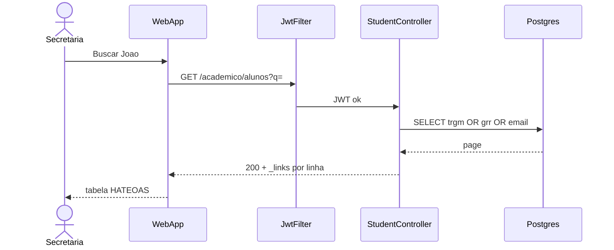

# F5.6-D01 — Busca de alunos

| Campo | Valor |
|---|---|
| HU | US-F5-003 |
| Escopo | lista paginada + `_links` por linha |
| Atores | Secretaria, WebApp, JwtFilter, StudentController, Postgres |
| Pré-condições | `user.manage_students`; debounce 300 ms |
| Origem | `docs/tcc-docs.md` §8.6 · CA-01 · RN-F5-003-02 |

## Passos

1. Secretaria busca por nome/GRR/e-mail (trigrama / igualdade / ILIKE).
2. Busca **não** filtra por curso — alunos de outros cursos aparecem.
3. `_links` (`edit`, `reset-password`, `matricula`) só se `curso_id` no escopo da secretaria.

## Mermaid

## Export

[`F5.6-D01-busca-alunos.puml`](./F5.6-D01-busca-alunos.puml)
