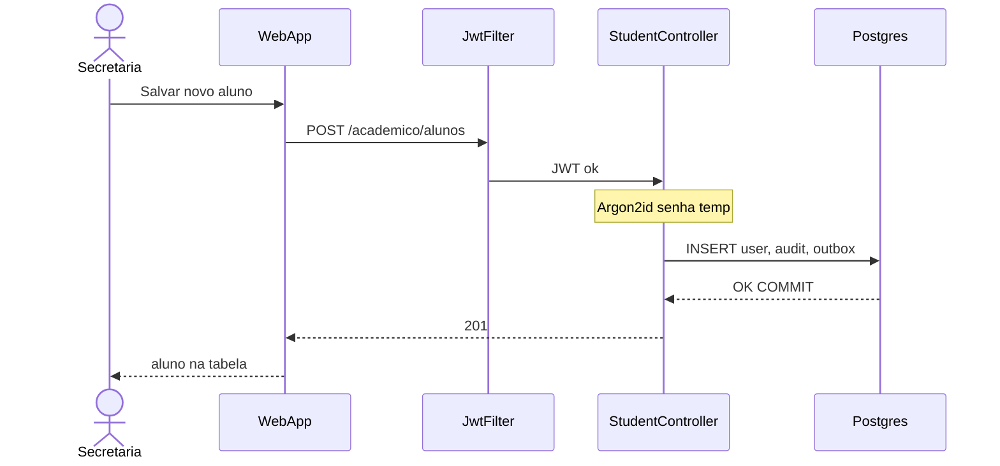

# F5.6-D02 — Cadastrar novo aluno

| Campo | Valor |
|---|---|
| HU | US-F5-003 |
| Escopo | `POST /academico/alunos` + Argon2id + audit + outbox boas-vindas |
| Atores | Secretaria, WebApp, JwtFilter, StudentController, Postgres |
| Pré-condições | `user.manage_students`; GRR e CPF livres |
| Origem | `docs/tcc-docs.md` §8.6 · CA-02 |

## Passos

1. Secretaria salva o Drawer.
2. Senha temporária gerada em memória + hash Argon2id **antes** da TX.
3. TX: INSERT usuário + `audit_log` + `outbox_event` (e-mail boas-vindas); `mustChangePassword=true`.

## Mermaid

## Export

[`F5.6-D02-cadastrar-aluno.puml`](./F5.6-D02-cadastrar-aluno.puml)
