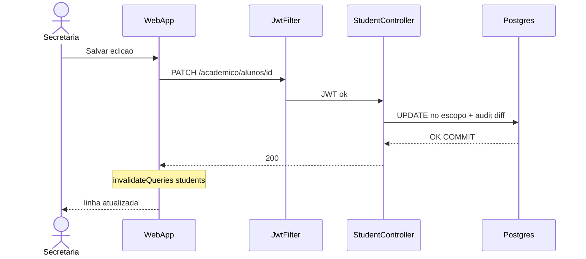

# F5.6-D03 — Editar aluno

| Campo | Valor |
|---|---|
| HU | US-F5-003 |
| Escopo | PATCH + `audit_log` (diff) + invalidateQueries |
| Atores | Secretaria, WebApp, JwtFilter, StudentController, Postgres |
| Pré-condições | `user.manage_students`; `_links.edit` presente |
| Origem | `docs/tcc-docs.md` §8.6 · CA-03 · RN-F5-003-08 |

## Passos

1. Secretaria salva alteração no Drawer.
2. UPDATE só se `curso_id` no escopo; fora → `404` (não vaza existência).
3. `audit_log` com diff `{campo, de, para}`; tabela atualiza sem reload.

## Mermaid

## Export

[`F5.6-D03-editar-aluno.puml`](./F5.6-D03-editar-aluno.puml)
